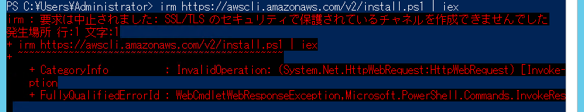
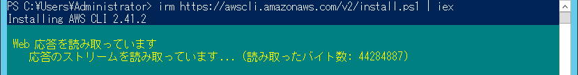
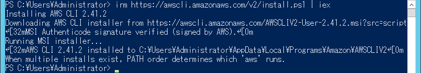

# インストール

以下のAWSの記事を参照

<a href="https://docs.aws.amazon.com/ja_jp/cli/latest/userguide/getting-started-install.html" target="_blank" rel=”noopener”>
    AWS CLI の最新バージョンのインストールまたは更新
</a>

<br>
<br>

## TLS通信の許可

公式の「irm https://awscli.amazonaws.com/v2/install.ps1 | iex」を実行すると「SSL/TLS のセキュリティで保護されているチャネルを作成できませんでした」というエラーになりました。



<br>

以下のコマンドで、TLS1.2通信を許可します。


```.ps1
[Net.ServicePointManager]::SecurityProtocol = [Net.SecurityProtocolType]::Tls12
```


<br>
<br>

## AWS CLIのインストール

AWS CLIをインストールします。

```.ps1
irm https://awscli.amazonaws.com/v2/install.ps1 | iex
```





<br>

インストール終了後パスを通します。

```.ps1
$awsPath = Join-Path $env:LOCALAPPDATA "Programs\Amazon\AWSCLIV2"
$currentPath = [Environment]::GetEnvironmentVariable("Path", "User")
[Environment]::SetEnvironmentVariable("Path", "$currentPath;$awsPath", "User")
```


<br>

AWS CLIのバージョンが表示されればOKです。
```.ps1
aws --version
```

